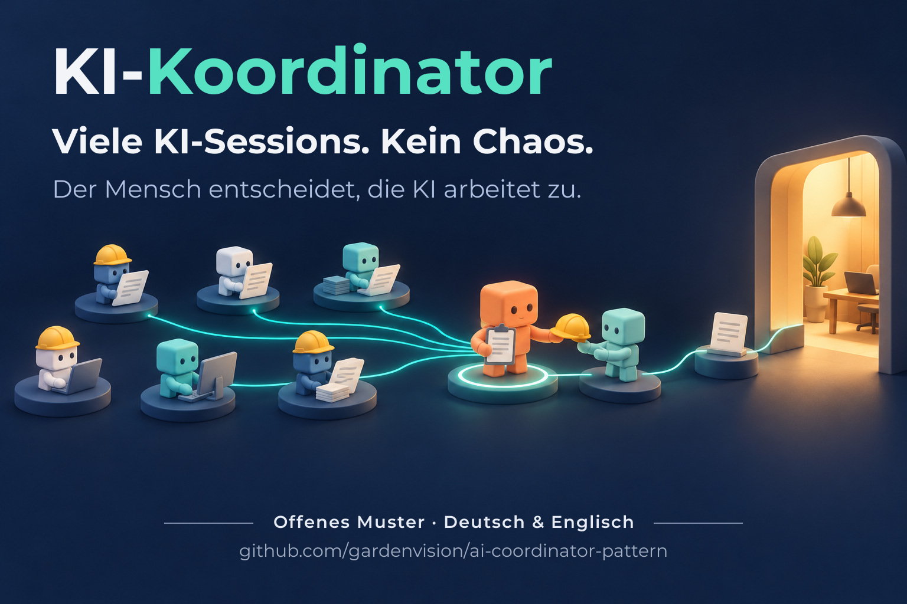

# KI-Koordinator-Muster – Kurzfassung



[English](README.md) · **Deutsch**

Fassung 1 · Stand 2026-10-21 · Kurzfassung zu [KI-Koordinator-Muster.md](de/KI-Koordinator-Muster.md) (Fassung 4.7) · zum Weitergeben

**Worum es geht:** Ein Mensch lässt viele KI-Sessions gleichzeitig an einem Projekt arbeiten. Eine davon ist der
**Koordinator**. Sie verteilt die Arbeit, vergibt knappe Ressourcen, lässt Ergebnisse unabhängig prüfen, führt Protokoll
und legt dem Menschen Entscheidungen vor. Der Mensch entscheidet, die KI arbeitet zu.

Das Muster ist in der Praxis gewachsen: zwei Rechner, mehr als 20 parallele Sessions, mehrere KI-Anbieter. Es passt auf
jedes Projekt mit vielen KI-Sessions – Software, Daten, Forschung oder Dokumentation. Es funktioniert mit Claude Code,
Codex, OpenCode und vergleichbaren Werkzeugen.

---

## Das Problem

Sobald mehrere KI-Sessions parallel laufen, passiert immer wieder dasselbe:

- Zwei Sessions arbeiten gleichzeitig im selben Programm und machen sich gegenseitig die Arbeit kaputt.
- Eine Session sagt „die andere hat schon zugestimmt“ – der Mensch wurde nie gefragt.
- Ergebnisse stehen nur im Chat. Eine Nachricht geht verloren, und alle warten.
- Zwei Sessions recherchieren dasselbe, und das Kontingent ist schneller leer als nötig.
- Niemand weiß mehr genau, welcher Stand gilt.

## Die Idee in einem Bild

```
                  Mensch (entscheidet, gibt Freigaben, testet)
                                    │
                        Koordinator (genau einer)
      ┌─────────────┬───────────────┼────────────────┬──────────────────┐
 Fach-Session   Fach-Session     Helfer          Stationsleiter     Zuarbeiter
 (je Aufgabe)   (je Aufgabe)   (kurzer Auftrag,  (je weiterem       (anderes Modell:
                                eigene Kopie)     Rechner)           Review, Recherche)
```

Der Koordinator setzt selbst nichts um. Er hält den Überblick, vergibt Reihenfolgen und prüft nach.

---

## Die zehn Regeln

1. **Der Mensch entscheidet.** Das Ja einer anderen Session ersetzt seines nie – auch nicht das Ja des Koordinators.
   *Warum:* Sonst reichen sich Sessions Freigaben weiter, die der Mensch nie gegeben hat.
2. **Genau ein Koordinator.** Er verteilt, prüft und protokolliert – und setzt nicht selbst um, auch nicht „nur kurz“.
   *Warum:* Zwei Chefs vergeben Nummern und Ressourcen doppelt. Wer selbst baut, lässt Nachrichten und Helfer warten und
   verliert den Überblick.
3. **Jede Aufgabe hat eine Akte.** Ziel, Stand, Nachweise und Übergabe stehen in einem Ordner, nicht nur im Chat.
   *Warum:* Nachrichten zwischen Sessions gehen verloren; die Akte bleibt. Eine neue Session macht dort weiter.
4. **Exklusive Ressourcen nur mit Sperre** – vorher sichern, hinterher nachmessen (mit Prüfsummen).
   *Warum:* Ein Editor, ein Testserver oder eine GPU verträgt nur einen Nutzer zur Zeit. Die Prüfsummen zeigen, ob nur
   das Gewollte geändert wurde. Der Mensch hat immer Vorrang; darum prüft der Koordinator vorher, ob er gerade arbeitet.
5. **Geteilte Dateien nur als Diff mit Basis-Prüfsumme.** Zentrale Nummern (z. B. Datenbank- oder Protokollversionen)
   vergibt der Koordinator erst beim Einspielen.
   *Warum:* Parallele Pakete überholen sich. Früh vergebene Nummern brechen dann die Reihenfolge.
6. **Größere Änderungen prüfen zwei andere Modelle.** Die bauende Session entscheidet je Befund.
   *Warum:* In der Praxis fand jedes der beiden Reviews Fehler, die dem anderen fehlten. Die Entscheidung bei der bauenden
   Session verhindert ein Hin und Her zwischen den Prüfern.
7. **Recherchen macht ein anderes, günstigeres Kontingent vor. Niemand sucht doppelt.**
   *Warum:* Die teure Session liest nur den fertigen Bericht. Sucht sie nebenher selbst, spart die Vorarbeit nichts.
8. **Versionsverwaltung, Löschen, Käufe und Uploads nur mit Ja des Menschen – in dem Chat, der es ausführt.**
   *Warum:* Diese Schritte lassen sich nicht oder nur schwer zurückholen.
9. **Werte erst nach Messung, Uhrzeiten von der Uhr, eigene Deutungen als Annahme.**
   *Warum:* Geschätzte Zeiten und ungeprüfte Werte klingen sicher, sind es aber nicht. Ein „überraschend schneller“
   Messwert kam einmal daher, dass gar nichts gezeichnet wurde.
10. **Jede Lehre geht ins Gedächtnis und als Regel an alle Sessions.**
    *Warum:* Der Koordinator hat keinen versteckten Zustand. Was nicht aufgeschrieben ist, kennt die nächste Session nicht.
    Das Gedächtnis wird darum selbst versioniert.

**Goldene Regel bei mehreren Rechnern:** Jeder Rechner mit eigener Werkbank ist ein eigener Bauplatz, nicht nur ein
Prüfplatz – verteile die Einbauten auf alle Bauplätze ([Goldene-Regel.md](de/Goldene-Regel.md)).

---

## So läuft eine Aufgabe

1. **Auftrag:** Der Koordinator vergibt eine ID, legt die Akte an und schreibt den Start-Prompt: Ziel, Pflichtlektüre,
   Wunsch des Menschen wörtlich, Phasen, Regeln, wohin das Ergebnis kommt.
2. **Varianten:** Die Fach-Session liest sich ein und legt Varianten mit einer klaren Empfehlung vor – noch ohne exklusive
   Ressourcen.
3. **Entscheidung:** Der Mensch wählt, gern kurz mit Kürzeln („1A 2B“) oder „alles nach Empfehlung“.
4. **Umsetzung:** offline in einer eigenen Arbeitskopie; bei größeren Änderungen vorher zwei Reviews; für die exklusive
   Ressource Sperre, Sicherung, GO und Nachmessen.
5. **Abnahme:** Der Mensch testet. Danach Protokolleintrag, Lehren ins Gedächtnis, Akte abschließen.

**Tag und Nacht:** Tagsüber entscheidet der Mensch. Nur wenn er es ausdrücklich abgibt (z. B. über Nacht), entscheidet
der Koordinator nach seinen eigenen, aufgeschriebenen Empfehlungen; morgens folgt ein kurzer Bericht. Nie ohne den
Menschen: Versionsverwaltung, Löschen, Käufe, Uploads.

---

## Passt das zu mir?

- **Ja**, wenn mehrere Sessions gleichzeitig laufen und lokale Programme (Editor, GPU, Testserver), mehrere eigene Rechner
  oder mehrere KI-Anbieter im Spiel sind.
- **Weniger nötig** bei einem reinen Code-Projekt ohne lokale Programme. Dort decken Cloud-Angebote mit parallelen
  Sessions vieles ab. Die Regeln (Freigaben, Akten, Reviews, Protokoll) lohnen sich trotzdem. Den Vergleich zeigt
  Abschnitt 16 des Musters.

## In 10 Minuten starten

1. Einen Ordner `koordinator/` anlegen mit leerem `PROTOKOLL.md`, `memory/INDEX.md` und einer Kopie des Musters.
2. Den **Projektblock** ausfüllen (Abschnitt 12 des Musters): Pfade, was nie verändert werden darf, exklusive Ressourcen,
   KI-Werkzeuge und Kontingente.
3. Eine neue KI-Session starten: „Du bist der Koordinator für <Projekt>. Lies `koordinator/KI-Koordinator-Muster.md` und
   den Projektblock. Arbeite danach.“

**Tipp:** Ein Koordinator entsteht am besten aus einer Session, die das Projekt schon gut kennt. Gut bleibt er, solange
Gedächtnis, Protokoll und Akten gepflegt werden – nicht durch ein besonders langes Regelwerk.

---

## Mehr dazu

- **Goldene Regel:** [Goldene-Regel.md](de/Goldene-Regel.md) – jeder Rechner mit eigener Werkbank ist ein Bauplatz.
- **Das ganze Muster:** [KI-Koordinator-Muster.md](de/KI-Koordinator-Muster.md) – Rollen, Routinen, Vorlagen (Start-Prompt, GO-Nachricht,
  Review- und Recherche-Auftrag, gebündelte Entscheidungsliste), typische Fehler, Vergleich mit Cloud-Angeboten.
- **Herkunft:** Das Muster ist 2026 in einem privaten Projekt entstanden. Eine ganz normale Fach-Session schrieb dort
  Anleitungen für andere Sessions – und fing irgendwann von selbst an nachzuprüfen, ob sie richtig ausgeführt wurden.

---

Urheber: Mathias Krill · Lizenz: [CC BY 4.0](LICENSE.md) · Aufgabenakten in der Praxis: [CanonTrail](https://github.com/gardenvision/CanonTrail)
