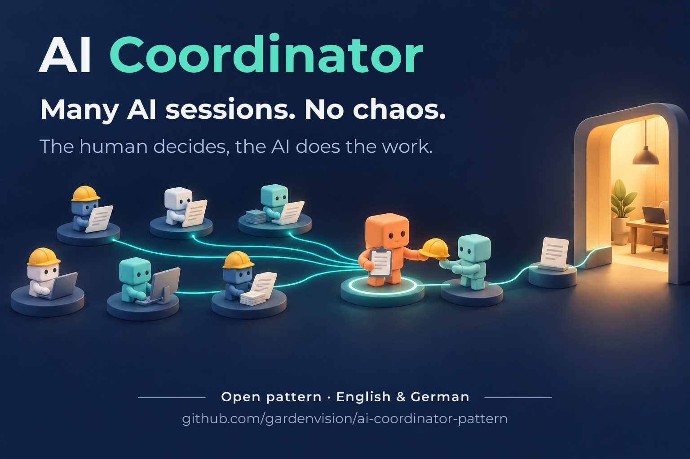

# AI Coordinator Pattern – Summary



**English** · [Deutsch](README.de.md)

Version 1 · As of 2026-10-21 · Summary of [AI-Coordinator-Pattern.md](en/AI-Coordinator-Pattern.md) (version 4.6) · for sharing

**What it is about:** One human lets many AI sessions work on one project at the same time. One of them is the
**coordinator**. It hands out the work, assigns scarce resources, has results checked independently, keeps a log and
puts decisions in front of the human. The human decides; the AI does the work.

The pattern grew out of practice: two computers, more than 20 parallel sessions, several AI providers. It fits any
project with many AI sessions – software, data, research or documentation. It works with Claude Code, Codex, OpenCode
and similar tools.

---

## The problem

As soon as several AI sessions run in parallel, the same things happen again and again:

- Two sessions work in the same program at the same time and break each other's work.
- One session says "the other one already agreed" – but the human was never asked.
- Results exist only in the chat. One message gets lost, and everyone waits.
- Two sessions research the same thing, and the quota runs out faster than needed.
- Nobody knows any more which state is the current one.

## The idea in one picture

```
                 Human (decides, gives approvals, tests)
                                    │
                        Coordinator (exactly one)
      ┌─────────────┬───────────────┼────────────────┬──────────────────┐
 Task session   Task session     Helper          Station lead       External worker
 (per task)     (per task)     (short job,       (per extra         (other model:
                                own copy)         computer)          review, research)
```

The coordinator does not build things itself. It keeps the overview, sets the order of work and checks the results.

---

## The ten rules

1. **The human decides.** The yes of another session never replaces the human's yes – not even the coordinator's yes.
   *Why:* Otherwise sessions pass on approvals that the human never gave.
2. **Exactly one coordinator.** It hands out work, checks and keeps the log – and does not build things itself, not even
   "just quickly".
   *Why:* Two bosses give out numbers and resources twice. Whoever builds lets messages and helpers wait and loses the
   overview.
3. **Every task has a task record.** Goal, status, evidence and handoff live in one folder, not only in the chat.
   *Why:* Messages between sessions get lost; the task record stays. A new session continues from there.
4. **Exclusive resources only with a lock** – back up before, re-measure after (with checksums).
   *Why:* An editor, a test server or a GPU can serve only one user at a time. The checksums show whether only the
   intended things changed. The human always has priority; so the coordinator first checks whether the human is working
   right now.
5. **Shared files only as a diff with a base checksum.** Central numbers (for example database or protocol versions)
   are assigned by the coordinator only when it integrates the change.
   *Why:* Parallel packages overtake each other. Numbers given out early then break the order.
6. **Two other models review larger changes.** The building session decides on each finding.
   *Why:* In practice, each of the two reviews found errors that the other one missed. Leaving the decision with the
   building session prevents back and forth between the reviewers.
7. **A different, cheaper quota does the research groundwork. Nobody searches twice.**
   *Why:* The expensive session reads only the finished report. If it also searches on its own, the groundwork saves
   nothing.
8. **Version control, deleting, purchases and uploads only with the human's yes – in the chat that carries them out.**
   *Why:* These steps cannot be undone, or only with great effort.
9. **Values only after measuring, times from the clock, own interpretations marked as assumptions.**
   *Why:* Estimated times and unchecked values sound certain, but they are not. A "surprisingly fast" measurement once
   came from the fact that nothing was rendered at all.
10. **Every lesson goes into memory and goes out to all sessions as a rule.**
    *Why:* The coordinator has no hidden state. What is not written down, the next session does not know.
    So the memory itself is kept under version control.

**Golden rule for several computers:** every computer with its own workbench is a building site of its own, not just a
test site – spread the integration work across all building sites ([Golden-Rule.md](en/Golden-Rule.md)).

---

## How a task runs

1. **Assignment:** The coordinator gives out an ID, creates the task record and writes the start prompt: goal, required
   reading, the human's wish word for word, phases, rules, where the result goes.
2. **Variants:** The task session reads up and presents variants with a clear recommendation – still without exclusive
   resources.
3. **Decision:** The human chooses, often briefly with short codes ("1A 2B") or "everything as recommended".
4. **Implementation:** offline in its own working copy; for larger changes two reviews first; for the exclusive
   resource: lock, backup, GO and re-measure.
5. **Acceptance:** The human tests. Then a log entry, lessons into memory, close the task record.

**Day and night:** During the day the human decides. Only when the human hands it over explicitly (for example
overnight) does the coordinator decide, following its own written recommendations; a short report follows in the
morning. Never without the human: version control, deleting, purchases, uploads.

---

## Does this fit me?

- **Yes**, if several sessions run at the same time and local programs (editor, GPU, test server), several of your own
  computers or several AI providers are involved.
- **Less needed** for a pure code project without local programs. There, cloud offerings with parallel sessions cover a
  lot. The rules (approvals, task records, reviews, log) still pay off. Section 16 of the pattern shows the comparison.

## Start in 10 minutes

1. Create a folder `coordinator/` with an empty `LOG.md`, `memory/INDEX.md` and a copy of the pattern.
2. Fill in the **project block** (section 12 of the pattern): paths, what must never be changed, exclusive resources,
   AI tools and quotas.
3. Start a new AI session: "You are the coordinator for <project>. Read `coordinator/AI-Coordinator-Pattern.md` and the
   project block. Work by them."

**Tip:** A coordinator is best grown from a session that already knows the project well. It stays good as long as
memory, log and task records are kept up to date – not through a particularly long rule book.

---

## More

- **Golden rule:** [Golden-Rule.md](en/Golden-Rule.md) – every computer with its own workbench is a building site.
- **The full pattern:** [AI-Coordinator-Pattern.md](en/AI-Coordinator-Pattern.md) – roles, routines, templates (start prompt, GO message, review and
  research request, bundled decision list), typical mistakes, comparison with cloud offerings.
- **Origin:** The pattern came about in 2026 in a private project. A perfectly ordinary task session wrote instructions for
  other sessions there – and at some point started on its own to check whether they had been carried out correctly.

---

Author: Mathias Krill · License: [CC BY 4.0](LICENSE.md) · Task records in practice: [CanonTrail](https://github.com/gardenvision/CanonTrail)
